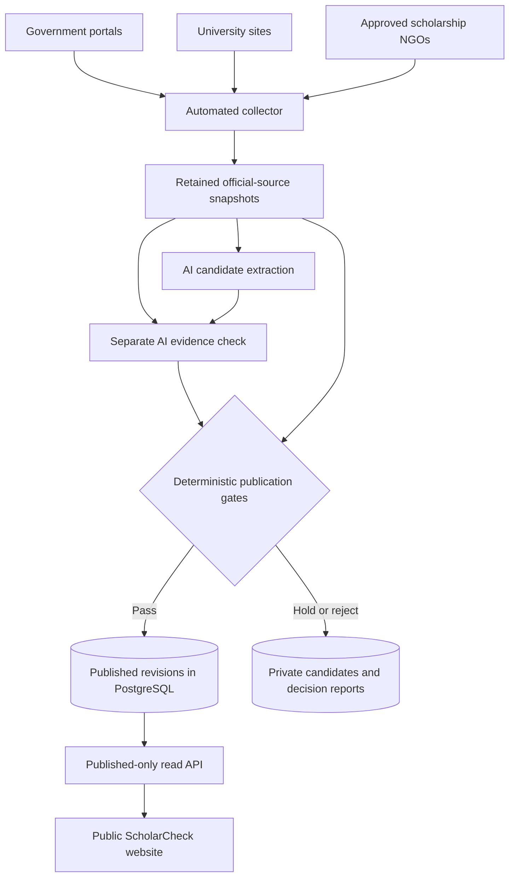

# ScholarCheck architecture

Owner architecture direction, 24 October 2026. This expands the supplied
source → collector → AI → database → website diagram with the evidence and
publication boundary required by `PUBLICATION-POLICY.md`.

## Boundaries

1. **Official sources:** Only allowlisted government portals, universities
   and established scholarship NGOs enter the collector. Use an official API
   or RSS feed when available; otherwise monitor permitted public pages.
   Access rules and source identity are recorded before fetching.
2. **Collector and snapshots:** Store the exact fetched content, URL, time,
   hash, response status and parser version. An unavailable page does not
   erase prior evidence or close a scholarship. Stage 1 collects selected
   launch sources; Stage 2 schedules rechecks of one published record; Stage 3
   adds discovery of new opportunities.
3. **AI extraction and evidence check:** One pass proposes structured facts
   with snapshot spans. A separate pass checks whether the spans support those
   facts for the correct scholarship, applicant group, degree level, round and
   rate year. Both outputs are proposals, not publication authority.
4. **Publication gate:** Code checks source permission, exact excerpt
   presence, values and qualifiers, schema, conflicts, duplicates, dates,
   routes and funding classification. It publishes only when all material
   claims are supported. An unclear or contradictory claim produces a private
   hold with reasons.
5. **Storage and website:** PostgreSQL stores candidates, decisions and
   immutable published revisions; the snapshot store retains the underlying
   content. The public API reads only published revisions and omits internal
   evidence passages and validation reports. The React website
   shows actual check dates and official links. Claim-linked evidence,
   snapshots, validation reports and gate or model details stay in the backend.

The repository now implements these boundaries: retained snapshots, the two-pass
validation pipeline, policy `.3`, atomic immutable publication, a published-only
API, the connected public website, problem reports and one-record monitoring.
The pipeline supports separate command adapters or stateless Responses API calls.
CGRS D has a recorded source review and passing report, proven through PostgreSQL;
RMIT remains private. Public responses are projected from immutable published
revisions, not the mutable seed tables.

One FastAPI process serves the API and production frontend build. PostgreSQL
stores reports, publication and monitoring state; private `var/` artifacts hold
model outputs and changed snapshots. The monitor runs separately on a schedule,
with database locks, retries and last-known-good retention. Production hosting,
real contact configuration, deployed smoke proof and a live model-provider run
remain pending. See [deployment instructions](DEPLOYMENT.md).
